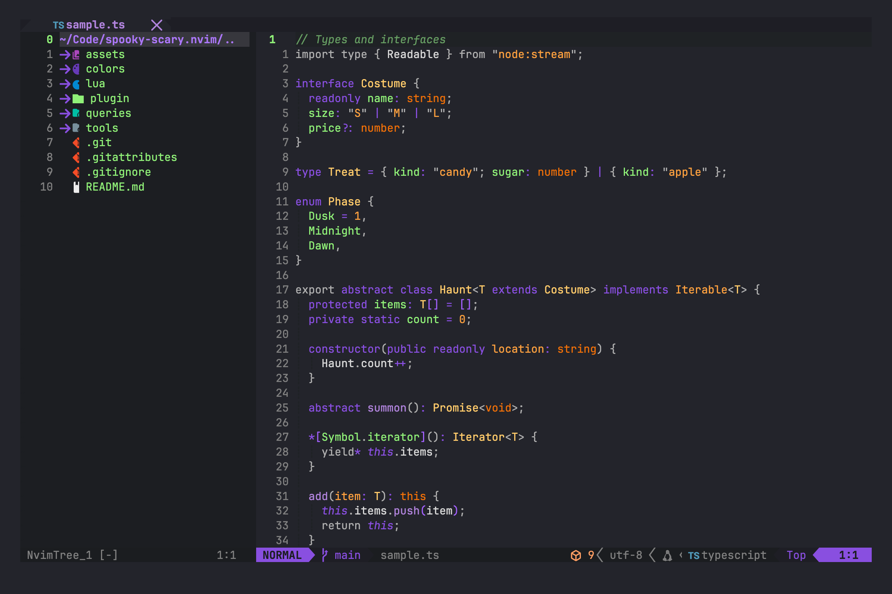

# Spooky Scary Color Theme for Neovim

A Neovim port of [Spooky Scary Color Theme](https://marketplace.visualstudio.com/items?itemName=rothecoder.spooky-scary-color-theme),
the Halloween VS Code theme by [Rojhan Paydar (rojhanpaydar)](https://github.com/rojhanpaydar/spooky-scary-color-theme).
Black, green, orange and purple, inspired by spooky season and Tim Burton films. This repository
contains only the Neovim colorscheme; the VS Code theme is hers, and the link above is the place
to get it.



The port is verified token by token against VS Code's own tokenizer, so what you see in Neovim is
what the VS Code theme paints, down to the ghost.

Install with lazy.nvim:

```lua
{
  "benjamin-chavez/spooky-scary.nvim",
  priority = 1000,
  config = function()
    vim.cmd.colorscheme("spooky-scary")
  end,
}
```

It requires `termguicolors` and uses treesitter captures. A lualine theme is included under the
same name, and highlight groups are defined for bufferline, nvim-tree, telescope, gitsigns,
nvim-cmp, indent-blankline, which-key, render-markdown and todo-comments.

The repo also ships small `queries/*/highlights.scm` extensions so Neovim can color string
quotes, brackets, block-scoped variables, JSON key depth and Markdown prose the way VS Code's
TextMate grammars do. They only add private `@spooky.*` captures, which no other colorscheme
defines, so switching themes renders exactly as before. `plugin/spooky-scary.lua` registers
the one query predicate they use.

## The ghost

The Power Mode ghost from the original theme's preview works in Neovim too, without Power Mode,
and it is on as soon as the colorscheme loads. `:SpookyHauntToggle` turns it off or on and remembers the choice
across sessions in Neovim's data directory; `:SpookyHauntEnable` and `:SpookyHauntDisable` do
the same explicitly. To change its settings, call setup after the colorscheme:

```lua
require("spooky-scary.haunt").setup({
  frequency = 20, -- keystrokes between hauntings, like powermode.explosions.frequency
})
```

Set `vim.g.spooky_scary_haunt = false` before loading the colorscheme if you never want it set
up at all.

Every twenty characters typed in insert mode, a small ghost rises out of the cursor line and
vanishes, the way it does in [the original theme's preview GIF](https://media.giphy.com/media/ZljsomV1FjhgkVIjYh/source.gif). Like Power Mode's mask
mode, it takes the color of whatever you are typing: purple in plain text, green in a tag,
orange in a string. In Ghostty, Kitty or WezTerm it is that GIF drawn with the Kitty
graphics protocol, cropped to the part Power Mode shows and pre-tinted for each theme color. In other terminals, or inside tmux, a ghost glyph rises and fades
instead. `:SpookyHaunt` summons it on demand, `graphics = "text"` forces the glyph version, and
`columns`, `rows` and `column_offset` move or resize it. `frames.lua` and the PNG frames under
`assets/ghost` come from `tools/ghost-frames.sh`.

The colors are verified against VS Code's own tokenizer by `tools/compare/run.sh`, which needs
Node, tmux and a local VS Code install for its grammars. It paints each sample in a real Neovim
and diffs every character. The few remaining differences are listed with reasons in
`tools/compare/known-differences.json`.

## Credits

- The theme, its palette and the idea are by [Rojhan Paydar (rojhanpaydar)](https://github.com/rojhanpaydar/spooky-scary-color-theme).
  Her theme file is kept unchanged under `tools/compare/reference/` as the fixture the port is checked against.
  This port is published with her permission.
- The ghost animation is by [Finkel Band](https://giphy.com/finkelband), as used in the original theme's Power Mode setup.
- Power Mode, which inspired the ghost, is [Cody Hoover's extension](https://marketplace.visualstudio.com/items?itemName=hoovercj.vscode-power-mode).
